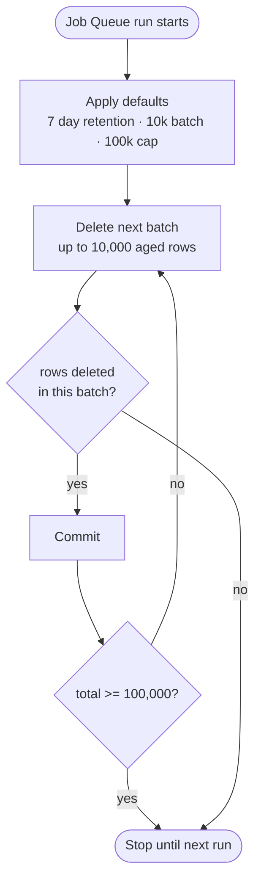

## TL;DR

This week I found the same misconfiguration in three unrelated Business Central
customer environments. The Change Log Setup had **Job Queue Category**,
**Job Queue Entry** and **Job Queue Log Entry** all set to log insertions,
modifications and deletions on every field. Job Queues write to those tables
constantly, so the Change Log Entry table was growing by thousands of rows a day
with no audit value. The built-in retention policies could not keep up and kept
timing out, so nothing was ever cleared.

The fix came in two parts. I truncated the existing junk Change Log Entries for
those three tables with a one-time upgrade codeunit, and I added a batched Job
Queue codeunit to keep Job Queue Log Entry itself under control going forward.

## The cause, repeated three times

In the **Change Log Setup (Table)** list, filtered on "Job", each environment had
three rows configured identically:

| Table                       | Log Insertion | Log Modification | Log Deletion |
| --------------------------- | ------------- | ---------------- | ------------ |
| Job Queue Category (471)    | All Fields    | All Fields       | All Fields   |
| Job Queue Entry (472)       | All Fields    | All Fields       | All Fields   |
| Job Queue Log Entry (474)   | All Fields    | All Fields       | All Fields   |

Every column set to "All Fields". Change logging was switched on globally, so all
three were live.

{: width="1817" height="242" loading="lazy"}

I doubt anyone set this deliberately. It looks like someone enabled change
logging, selected "all tables" in a hurry, or copied setup data between
environments without reviewing it. Either way it sat there quietly doing damage.

## Why this is a problem

**There is no useful audit trail to be had from these tables.** Job Queue
Category is reference data that rarely changes. Job Queue Entry and Job Queue Log
Entry are operational plumbing. Knowing that a job's "Last Ready State" or status
field changed at 02:14 tells you nothing you would ever investigate.

The volume is the real issue. Every time a Job Queue runs, Business Central
updates the Job Queue Entry row (status, last run time, error text) and inserts a
Job Queue Log Entry row. With change logging on, each of those writes produces
Change Log Entry records. On a tenant with a handful of frequent recurring jobs,
say one every few minutes, that is thousands of Change Log Entry rows per day
that describe nothing worth keeping.

Business Central's retention policies are supposed to trim Change Log Entry, but
they are well known for struggling with very large tables and timing out before
they finish. Once the table is big enough that the cleanup cannot complete inside
its window, it never catches up. In all three environments the Change Log Entry
table had grown into the millions and was never being cleared.

## The fix, part 1: truncate the existing entries

The existing rows for those three tables are pure noise, so the fastest way to
deal with them is a bulk delete gated behind an upgrade tag so it runs once.

```al
codeunit 89002 "Upgrade"
{
    Subtype = Upgrade;

    trigger OnUpgradePerCompany()
    begin
        TruncateChangeLogEntries();
    end;

    var
        UpgradeTag: Codeunit "Upgrade Tag";

    local procedure TruncateChangeLogEntries()
    var
        ChangeLogEntry: Record "Change Log Entry";
    begin
        if UpgradeTag.HasUpgradeTag(GetTruncateChangeLogEntriesUpgradeTagCode()) then
            exit;

        ChangeLogEntry.SetFilter("Table No.", '%1|%2|%3', Database::"Job Queue Entry", Database::"Job Queue Log Entry", Database::"Job Queue Category");
        ChangeLogEntry.Truncate(true);

        UpgradeTag.SetUpgradeTag(GetTruncateChangeLogEntriesUpgradeTagCode());
    end;

    local procedure GetTruncateChangeLogEntriesUpgradeTagCode(): Code[250]
    begin
        exit('_Upgrade_TruncateChangeLogEntries_008092026');
    end;
}
```

The codeunit checks its upgrade tag and exits if it has already run. Otherwise it
filters Change Log Entry down to the three offending table IDs and calls
`Truncate`, then records the tag so the next upgrade skips it.

`Truncate` does a set-based bulk delete rather than walking the table row by row,
so it clears millions of entries in seconds where `DeleteAll` would run for
countless hours attempting to handle 100m records. It is allowed here because the Change Log Entry table has no delete
event subscribers and none of the other characteristics that rule it out.

## A closer look at Record.Truncate

`Record.Truncate` was [available with AL runtime version
16.0](https://learn.microsoft.com/en-us/dynamics365/business-central/dev-itpro/developer/methods-auto/record/record-truncate-method).
It deletes, in one efficient set-based operation, every record that falls within
the record variable's current filters. With no filters applied it empties the
table.

Two things are worth understanding before you reach for it:

- **Concurrency.** `Truncate` actually allows *less* concurrency than `DeleteAll`,
  not more: the whole table is locked until the transaction commits. It is the
  right tool for a one-time upgrade or a quiet-window cleanup, not for something
  that runs against a live, busy table.
- **The parameter.** The optional boolean is `ResetAutoIncrement`, and it
  defaults to `true`. It controls whether an AutoIncrement column restarts from
  its initial value; tables without one ignore it. It is *not* a "run triggers"
  flag.

Per the Microsoft Learn documentation, `Truncate` is **not supported**, and you
should use `DeleteAll` instead, when any of these apply:

- The table has `OnBeforeDelete` / `OnAfterDelete` (delete) event subscribers.
- Temporary tables, system tables, or tables whose type is not `Normal`.
- Called from within a `TryFunction`.
- The table has a security filter applied.
- The current filters use FlowFields, or a high number of marked records.
- The table has media fields.

Capture the return value (`Ok := Rec.Truncate(...)`) if you want to handle the
unsupported case yourself; omit it and an unsupported call raises a runtime
error. And because it deletes everything matching the current filters, set those
filters deliberately before you call it — it is most efficient when the majority
of the table matches anyway.

## The fix, part 2: Job Queue Log Entry cannot be truncated

Truncating Change Log Entry handles the symptom. Job Queue Log Entry still grows
on its own, and here `Truncate` is not an option: the base application
subscribes to that table's delete events, so the runtime blocks the call.

The alternative is an ordinary per-record delete, done in bounded batches so it
never holds a big transaction or a wide lock. I run this as a recurring Job Queue
Entry outside business hours.

```al
codeunit 89003 "Delete Job Queue Log Ent."
{
    // Job Queue codeunit: deletes Job Queue Log Entries older than 7 days.
    // Commits after every 10,000 deleted records and stops after 100,000 per run.
    InherentEntitlements = X;
    InherentPermissions = X;

    trigger OnRun()
    begin
        DeleteAgedLogEntries();
    end;

    var
        RetentionDays: Integer;
        CommitBatchSize: Integer;
        MaxDeletionsPerRun: Integer;

    procedure SetRetentionDays(NewRetentionDays: Integer)
    begin
        RetentionDays := NewRetentionDays;
    end;

    local procedure DeleteAgedLogEntries()
    var
        RetentionDateTime: DateTime;
        DeletedTotal: Integer;
        DeletedInBatch: Integer;
    begin
        ApplyDefaults();
        RetentionDateTime := CreateDateTime(CalcDate('<-' + Format(RetentionDays) + 'D>', Today), 0T);

        repeat
            DeletedInBatch := DeleteBatch(RetentionDateTime, MaxDeletionsPerRun - DeletedTotal);
            DeletedTotal += DeletedInBatch;
            if DeletedInBatch > 0 then
                Commit();
        until (DeletedInBatch = 0) or (DeletedTotal >= MaxDeletionsPerRun);
    end;

    local procedure DeleteBatch(RetentionDateTime: DateTime; RemainingCap: Integer) DeletedInBatch: Integer
    var
        JobQueueLogEntry: Record "Job Queue Log Entry";
        BatchLimit: Integer;
    begin
        BatchLimit := CommitBatchSize;
        if RemainingCap < BatchLimit then
            BatchLimit := RemainingCap;
        if BatchLimit <= 0 then
            exit(0);

        JobQueueLogEntry.SetFilter("Start Date/Time", '<%1', RetentionDateTime);
        if not JobQueueLogEntry.FindSet() then
            exit(0);

        repeat
            JobQueueLogEntry.Delete(true);
            DeletedInBatch += 1;
        until (JobQueueLogEntry.Next() = 0) or (DeletedInBatch >= BatchLimit);
    end;

    local procedure ApplyDefaults()
    begin
        if RetentionDays <= 0 then
            RetentionDays := 7;
        CommitBatchSize := 10000;
        MaxDeletionsPerRun := 100000;
    end;
}
```

The design choices matter here:

- `Delete(true)` runs the delete trigger and the base application subscribers per
  record, which is exactly what you want for this table.
- Deleting in batches of 10,000 with a `Commit()` between them keeps each
  transaction short and the lock footprint small, so the job does not fight with
  daytime activity if it overruns.
- The hard cap of 100,000 rows per run bounds how long any single scheduled run
  takes. If there is a backlog, it drains over several runs instead of one long
  one.
- Schedule it as a recurring Job Queue Entry in a quiet window, for example every
  night at 01:00.



Change Log Entry has a matching problem if any high-volume table is logged, but
in these environments turning the setup off was enough. If you do need a code
cleanup for Change Log Entry on an ongoing basis, the same batched pattern works,
since that table has no delete triggers or subscribers.

## Recommendations

**Review Change Log Setup regularly.** Only log tables where the audit trail has
genuine business value: master data, posting setup, permissions, sensitive
document fields. Job Queue tables almost never qualify, and neither do most
Integration or logging tables.

**Do not rely solely on retention policies for high-volume tables.** They are
fine for steady, moderate volumes. Once a table is large or growing fast, assume
the policy will time out and never recover, and plan a code-based cleanup
instead.

**Know the Truncate versus batched-Delete trade-off.** Use `Truncate` when the
table has no delete trigger logic and no delete subscribers and you want the
whole filtered set gone quickly. Use batched `Delete(true)` with periodic commits
when triggers or subscribers must run, or when you need each run to stay bounded.

<!-- PERSONAL EXPERIENCE: Same misconfigured Change Log Setup (Job Queue Category 471, Job Queue Entry 472, Job Queue Log Entry 474 all set to All Fields on insert/modify/delete) found independently across three separate BC customer tenants in one week; Change Log Entry tables had grown into the millions because built-in retention policy runs were timing out. -->
<!-- UNIQUE INSIGHT: The practical decision rule for cleanup on BC log tables is driven by delete-trigger/subscriber presence: Change Log Entry has none so Truncate is valid, Job Queue Log Entry has base-app delete subscribers so only batched Delete(true) is valid. -->

If you look after more than one Business Central environment, it is worth
spending ten minutes in each one checking the Change Log Setup this week. In my
experience the same mistakes travel between tenants.

---

**Sample code:** [LewisHyett/BCExamples / Maintenance](https://github.com/LewisHyett/BCExamples/tree/main/Maintenance)
— both codeunits in full: `TruncateChangeLogEntries` for the one-time clear-out,
and `DeleteJobQueueLogEntries` for the recurring batched job.
