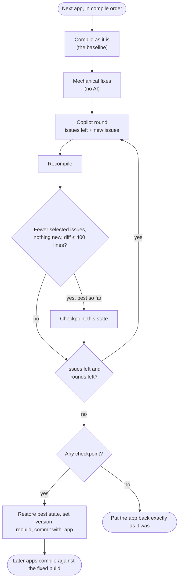

## TL;DR

If you look after a lot of Business Central customers, you probably know the
feeling: a major release is coming, and somewhere in all those repos there's an
extension that uses a table Microsoft is about to remove. You just don't know
which one yet.

I got tired of finding out on upgrade day, so I built two Azure DevOps
pipelines:

1. **The compile check** clones every AL app in every customer project,
   compiles the lot against the BC version you pick (`Current`, `NextMinor` or
   `NextMajor`) and hands you an interactive HTML report showing exactly what
   breaks. No Docker, no BC container. It runs by itself once a month.
2. **The fix pipeline** takes what the check found and has a go at fixing it, on
   a new branch in each repo. Simple fixes are scripted, and the rest goes to
   **GitHub Copilot CLI**. Every change gets recompiled, and it's only kept if
   it actually helped. It pushes branches but never opens a pull request:
   a person always reviews the change first.

Here's the end result before we get into how it works:

{: loading="lazy"}

## Why I bothered

Microsoft ships two major Business Central releases a year, and each one removes
things that were marked obsolete a while earlier. That's fair enough, and the
warnings are there long in advance. The trouble is acting on them across dozens
of customers.

Checking by hand means, for every repo: clone it, work out its dependencies
(some in other repos in the same project, some our own IP apps on a NuGet feed,
some third-party), get symbols for the next version, compile, read the errors
and write them down somewhere. Then do it again for the next repo, and the next
customer. Realistically, that only happens when an upgrade is already close.

So I wanted a list I could look at months ahead, showing which customers are
fine, which need work, and what exactly the work is.

## Part 1: the compile check

### Compiling without a container

The core of it is BcContainerHelper's compiler folder support. Instead of
spinning up a BC container, it downloads the sandbox artifacts for the target
version once and builds a folder with the AL compiler and Microsoft's symbols
in it. Later runs for the same version reuse that folder:

```powershell
$select      = @{ Current = 'Latest'; NextMinor = 'NextMinor'; NextMajor = 'NextMajor' }[$Target]
$artifactUrl = Get-BcArtifactUrl -type Sandbox -country $Country -select $select -accept_insiderEula
$version     = $artifactUrl.Split('?')[0].Split('/')[4]
$compilerName   = "bc-$Country-$version"
$compilerFolder = Join-Path $bcContainerHelperConfig.hostHelperFolder "compiler\$compilerName"

if (-not (Test-Path $compilerFolder)) {
    $compilerFolder = New-BcCompilerFolder -artifactUrl $artifactUrl -containerName $compilerName `
                                           -cacheFolder (Join-Path $WorkRoot 'artifacts')
}
```

Each app is then compiled with `Compile-AppWithBcCompilerFolder` and
`-generateErrorLog`. That JSON error log is the bit I really wanted: every
diagnostic comes with a rule ID, severity, file and line, and each one becomes a
row in the report. I also work out which AL object each diagnostic sits in (the
last `<type> <id> <name>` declaration at or above that line), so the report can
say *TableExtension 50100* rather than just a file path.

### Dependencies: the hard part

Compiling one app is easy. Compiling a whole customer project *correctly* is
where most of the time went:

- **Apps compile in dependency order, across every repo in a project.** The
  project shares one symbols folder, and each app that builds is added to it,
  so apps that depend on it compile against the current source rather than an
  old `.app`.
- **Our IP apps and third-party apps come from NuGet.** Our released IP lives
  on an Azure Artifacts feed, and ISV apps come from Microsoft's
  AppSourceSymbols feed. `Download-BcNuGetPackageToFolder -select LatestMatching`
  picks the newest version that works with the target BC version and is at
  least the version in `app.json`. Each resolved tree is cached for the rest of
  the run, so the next customer using the same app gets it for free.
- **Checking one repo still finds its dependencies.** If you only check one
  repo, the apps it needs from the project's other repos are found through the
  Azure DevOps REST API (it reads their `app.json` files without cloning),
  cloned and compiled as dependencies only. Their own issues stay out of the
  report.
- **One broken app doesn't bury everything after it.** If an app's source won't
  compile, the check looks for a built `.app` committed in that repo and uses it
  instead, so the apps that depend on it can still be checked. They get a
  `FALLBACK` warning so you know. If there's no committed `.app`, they get one
  `DEPENDENCY` error naming the real cause, instead of hundreds of confusing
  "missing object" errors.

It also quietly skips things that would only add noise: disabled or empty repos,
data fix repos (by name), apps with `"target": "OnPrem"` (the check compiles
against the online sandbox) and `app.json` files that aren't BC apps at all.

### Running it

The pipeline (`azure-pipelines.yml`) runs on a Microsoft-hosted `windows-latest`
agent with the maximum 6-hour timeout. It kicks off on its own at 22:00 UTC on
the 1st of every month against `NextMajor`, so the report is waiting the next
morning:

```yaml
trigger: none   # don't run on commits to this tools repo

schedules:
  - cron: '0 22 1 * *'
    displayName: Monthly NextMajor check
    branches:
      include: [ main ]
    always: true
```

You can also run it yourself against one project, a group of projects
(comma-separated wildcards) or a single repo, which is handy just before a
particular customer's upgrade.

{: loading="lazy"}

A small tip if you build something similar: pass project and repo names to your
script through **environment variables** rather than pasting them into the
script text. A customer name with an apostrophe in it will happily break a
single-quoted PowerShell string.

The report is also written after every project, not only at the end. If a run
hits the timeout, you still get a report for everything it finished, clearly
labelled as *partial*.

## A tour of the report

Everything ends up in a single `report.html` with the run's data embedded
inside it, so it works offline and you can email it or drop it on SharePoint.
Each repository gets one of three statuses:

| Status | Meaning |
|---|---|
| **Blocked** | At least one error: the app won't compile against this version until it's fixed |
| **Plan for** | Warnings only: it installs, but something will break in a later version (usually obsolete objects) |
| **Ready** | Nothing to do |

The report has four tabs, each written for a different reader.

### Readiness summary: for managers and customer updates

This is the "how worried should we be?" view. You get a one-line verdict (for
example, *38 of 40 repositories compile against this version*), a coloured bar
of blocked, warning and clean repos, and then a card for each repo that needs
work, with each problem explained in plain English and what to do about it.

**Copy summary** gives you plain text for Teams or an email, and **Print / PDF**
gives you a clean printable version.

### Triage by cause: for developers

This is the tab to hand to whoever is doing the fixing. It groups every issue by root cause, so if
Microsoft removed one table that six customers use, you see that as one problem
with six places to fix, not six separate problems.

{: loading="lazy"}

It also has an **Obsolete objects in use** table: each obsolete object or
element listed once, whether it's already removed or only marked for removal,
the version tag, and Microsoft's reason, which usually names the replacement.
Already-removed objects come first, because those are the ones that block you.

### Repository worklist: for working through the fixes

One row per repository, worst first, with repos that have errors already
expanded. Expand any repo to see its issues with the app, AL object, file and
line. **Copy as work item** gives you Markdown you can paste straight into an
Azure DevOps work item.

{: loading="lazy"}

### All issues: everything, with filters

Every error and warning in one table, with filters for customer, repository,
app, cause and code. The filters only offer values that still have issues under
the other filters, which saves a lot of clicking into empty results. Press
**/** to jump to the search box, and **Export CSV** downloads whatever you're
looking at.

{: loading="lazy"}

Diagnostic codes link to their Microsoft Learn pages, and new codes need no
upkeep: the report works out a cause from the compiler's own message.

### Bonus: a draft customer document

If you tick **Create customer documents**, the check also writes a first-draft
*Upgrade Assurance Release Notes* Word document for each customer. It includes
the release wave and version, their bespoke extensions, a conflict table with
PASSED/FAILED per extension, and the errors and warnings. It's filled from the
report data by a plain PowerShell script with no AI involved, so the same
results always give the same document. Someone still reads it before it goes
out, of course.

## Part 2: the fix pipeline

Once you have a list of what's broken, you start noticing that much of it is
repetitive: a removed field with a named replacement, an event that moved, a
duplicate Base Application dependency. That's a good job for an AI coding agent,
as long as nothing it does is trusted until the compiler agrees.

### What a run does

The fix pipeline starts by running the compile check, keeping its clones,
symbols and build order (`-KeepWorkspace -FullClone`). Then it works through
each app in dependency order:



In plain words:

1. **Baseline.** Compile the app as it is, against exactly the symbols the check
   used.
2. **Mechanical fixes.** Anything with a safe scripted fix is handled with no AI
   at all. Right now that's AL0702, where `app.json` lists Base Application as
   a dependency *and* brings it in through the `application` property. The
   script removes the extra entry and refuses to save if the result isn't valid
   JSON.
3. **Copilot rounds.** GitHub Copilot CLI gets the remaining issues, the symbols
   and four MCP servers, and then the app is recompiled. Whatever's left, plus
   anything new it caused, goes into the next round, up to a set number of
   rounds (two by default).
4. **Keep or put back.** The changes stay only if the selected issues went down,
   nothing new appeared and the diff is 400 changed lines or fewer. Otherwise
   the app goes back exactly as it was.
5. **Version and commit.** The app's version becomes the BC major it was
   compiled against, with the middle parts unchanged and today's date at the
   end (`21.2.0.20221216` becomes `29.2.0.20261013`). It's rebuilt, and one
   commit per app goes onto a `bcfix/<target>-v<major>-<build id>` branch with
   the compiled `.app` included.
6. **Push.** Each branch with commits is pushed. No pull request is created;
   that's your call.

When you queue it, you choose what to fix: `Errors`, `Errors+Obsolete` (errors
plus the AL0432/AL0433/AL0520 obsolete warnings), or a list of specific codes
such as `AL0432,AL0185`.

{: loading="lazy"}

### "No new issues" is stricter than it sounds

The obvious rule is "are there fewer errors than before?". Sadly that's not
enough. An agent can fix one obsolete call by swapping it for a *different*
obsolete call, and the total stays the same or even goes down. So a change must
not add to any error **or** to any of the issues being fixed, and it's counted
per issue rather than as a set. A second copy of an issue that was already
there still counts as new:

```powershell
function Get-IssueKey($Issue) { "$($Issue.Code)|$($Issue.File)|$($Issue.Message)" }   # lines move as code is edited

function Get-NewIssues([object[]]$Issues, [object[]]$Base) {
    # Compared as counts per key, not as a set: a second copy of an issue already in the baseline is new too
    $left = @{}
    foreach ($i in $Base) { $k = Get-IssueKey $i; $left[$k] = 1 + [int]$left[$k] }
    @(foreach ($i in $Issues) { $k = Get-IssueKey $i; if ($left[$k]) { $left[$k]-- } else { $i } })
}
```

Line numbers are left out of the key on purpose. The moment Copilot adds a line
near the top of a file, every line number below it shifts.

### The best round wins, not the last one

More rounds don't always mean better. Round one might fix eight of ten issues
cleanly, and round two, chasing the last two, might break something else. So
after every step the app folder is saved as a git tree (`git add -A`, then
`git write-tree`) whenever it passes the keep rules and is the best so far. If
the last round wasn't the best, the app is restored from that tree and compiled
again to prove it, and the commit message says which round was kept and why the
later ones were dropped.

### Keeping Copilot on a short lead

Copilot CLI runs non-interactively, with a fairly strict set of switches:

```powershell
$copilotArgs = @(
    '-p', 'Read .bcfix/task.md in this folder and carry out the task it describes. Work on your own without asking questions.'
    '-C', $App.AppFolder
    '--allow-all-tools', '--deny-tool', 'shell'   # file and MCP tools only: no shell, so no git, network or installs
    '--no-ask-user', '--disable-builtin-mcps', '--no-remote', '--no-auto-update'
    '--additional-mcp-config', "@$mcpFile"
    '--allow-url', 'learn.microsoft.com'
    '--secret-env-vars', 'ADO_PAT,COPILOT_GITHUB_TOKEN,GH_TOKEN,GITHUB_TOKEN'
    "--share=$(Join-Path $LogFolder "round$Round.md")"
    '--usage-output-file', (Join-Path $LogFolder "round$Round-usage.json")
)
```

What that means in practice:

- **No shell.** It can read and edit files and use its MCP tools, but it can't
  run git, install anything or reach the internet beyond Microsoft Learn.
- **Only the app folder.** Anything it changes outside the app folder is put
  back after each round.
- **No push credentials.** This one's easy to miss: `--secret-env-vars` hides
  values from the model, but not from the MCP server processes Copilot starts,
  which inherit its environment. So the Azure DevOps PAT used for pushing is
  taken out of the environment completely while Copilot runs, and put back
  afterwards.
- **Everything is logged.** The full transcript and AI credit usage of each
  round go into the pipeline artifact.

On the Azure DevOps side, the pipeline can push branches to any repo its PAT can
write to, and every run spends Copilot credits, so only a small group of people
can queue it.

### What Copilot is told

Each round's task is a short template: the app, the BC version, the round
number and the list of issues with their AL object, file and line. If earlier
changes caused something new, that gets its own *new issues to fix first*
section. After that comes a fixed set of rules. The important ones:

- Fix only the listed issues, with the smallest change. No refactoring,
  reformatting or tidying up.
- Keep the existing behaviour. If Microsoft's obsolete reason names a
  replacement, use it the way it's meant to be used. If a fix might change
  behaviour in a way that can't be checked, leave it and explain why.
- Don't touch `app.json`, `.alpackages` or any `.app` file: the pipeline
  handles versions and builds.
- Never add `#pragma warning disable` or `ObsoleteState` to make an issue go
  away, and don't delete objects to get rid of errors.
- Look things up in the symbols with the MCP tools instead of guessing
  signatures.
- Follow our object naming conventions for anything new, and use an ID from the
  app's own `idRanges`.

And these are the MCP servers it gets, set up per app:

| Server | Used for |
|---|---|
| `al` (Microsoft's AL tools, `al launchmcpserver`) | Symbol search and compiling against the app's symbols |
| `al-symbols` (`al-mcp-server`) | Object definitions, members and references in `.alpackages` |
| `bc-code-intelligence` | BC patterns and best practice |
| `microsoft-learn` | Diagnostic pages, *What's new* and replacement guidance |

One detail worth sharing: the compiler doesn't need Microsoft's own apps in the
symbols folder, because it adds them from the compiler folder itself. Copilot
does need them, though. Without System Application, Base Application, Business
Foundation and the app's other Microsoft dependencies in `.alpackages`, it has
no way to look up something like *No. Series*, so they're copied in before each
app.

### Commit messages a reviewer can actually use

Each commit message comes in two parts. The pipeline writes the facts: which
codes were fixed, how many out of how many, the version change, which `.app` is
included and what's still left. Copilot writes the rest to
`.bcfix/commit-message.md`, in a fixed shape:

```
What changed:
- <file or object>: <what was changed and why>

What did not change:
- <issues left unfixed and why>
- <behaviour deliberately kept that a reviewer might expect to change>
```

The *What did not change* section matters most. That's where Copilot says
things like "the replacement event has a different signature and I couldn't
verify the mapping", which is exactly where a reviewer should look first.

{: loading="lazy"}

### When a run finishes

The run's summary page lists each repo with a link to its branch, and for each
app: selected issues before and after, new issues, changed lines, rounds used
and the result (*Committed*, *Reverted: …*, *Nothing to fix* or *Blocked: …*).

{: loading="lazy"}

The artifact holds a `.patch` per repo, every Copilot log, and two copies of
the report: `before\report.html` and `fix\after-report.html`, so you can see
side by side what changed.

{: loading="lazy"}

The run also goes orange (*partially succeeded*) rather than green when
something needs a look: a push failed, a repo was skipped, Copilot itself
failed, or no app with issues got a fix committed. A green tick on a run that
didn't actually fix anything would be far too easy to miss.

## What's next

- **More mechanical fixes.** Every code that can be fixed by a script is one less
  thing to spend AI credits on, and one less thing to review closely. The fixers
  are a simple table of code to script block, and each one still has to pass
  the same recompile check.
- **Compiling isn't the same as working.** The fix pipeline proves the app
  compiles and that nothing new broke at compile time. It doesn't run tests or
  check behaviour, and that's exactly why it stops at a branch and leaves the
  pull request to a person.
- **Service connections instead of PATs.** Both pipelines use PATs stored as
  secret variables, and PATs expire. A workload identity would save me one more
  calendar reminder.

The big change for me is *when* we find out. Instead of discovering on upgrade
day that a customer's extension uses a removed table, the monthly report says
so months ahead, and the fix pipeline can have a branch ready for review before
anyone starts on it by hand.

If you're looking after a lot of BC customers and something like this would be
useful to you, I'd love to hear how you're handling upgrades today.
