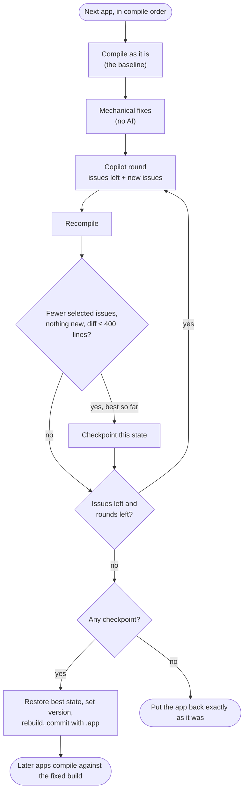

## TL;DR

Before every Business Central major release I want to know which customer
extensions will stop compiling, and I want to know early enough to fix them
calmly. I built two pipelines for that:

1. **The compile check** clones every AL app in every customer project in our
   Azure DevOps organisation, compiles them against the chosen BC version
   (`Current`, `NextMinor` or `NextMajor`) and produces an interactive HTML
   report, CSVs and, optionally, a first-draft upgrade document per customer.
   No Docker and no BC container are involved: it uses the AL compiler from the
   BC artifacts via BcContainerHelper. It runs on its own once a month.
2. **The fix pipeline** takes what the check found and fixes it on a new branch
   in each repo. Mechanical fixes go first, then **GitHub Copilot CLI** with
   the AL and Microsoft Learn MCP servers. Every change is recompiled, and it is
   kept only if the selected issues went down, nothing new appeared and the diff
   is small enough to review. It pushes branches and never opens a pull request:
   a developer reviews each branch and opens the PR themselves.

## The problem: finding out too late

Microsoft ships two major Business Central releases a year, and each one removes
things that were marked obsolete a year or so earlier. If you look after a lot
of customers, each with a handful of per-tenant extensions spread over several
repos, the honest answer to "will everything still compile on the next major?"
is usually "we'll find out when the upgrade window opens".

Doing it by hand means, per repo: clone it, find its dependencies (some in other
repos in the same project, some our own IP apps on a NuGet feed, some
third-party), download symbols for the next version, compile, read the errors,
and write them down somewhere. Multiply that by every repo in every customer
project and it doesn't get done until it is urgent.

## Part 1: the compile check

### How an app gets compiled without a container

The core is BcContainerHelper's compiler folder support. Instead of spinning up a
BC container, it downloads the sandbox artifacts for the target version once and
builds a folder containing the AL compiler and the Microsoft symbols:

```powershell
$select      = @{ Current = 'Latest'; NextMinor = 'NextMinor'; NextMajor = 'NextMajor' }[$Target]
$artifactUrl = Get-BcArtifactUrl -type Sandbox -country $Country -select $select -accept_insiderEula
$version     = $artifactUrl.Split('?')[0].Split('/')[4]
$compilerName   = "bc-$Country-$version"
$compilerFolder = Join-Path $bcContainerHelperConfig.hostHelperFolder "compiler\$compilerName"

if (-not (Test-Path $compilerFolder)) {
    $compilerFolder = New-BcCompilerFolder -artifactUrl $artifactUrl -containerName $compilerName `
                                           -cacheFolder (Join-Path $WorkRoot 'artifacts')
}
```

Each app is then compiled with `Compile-AppWithBcCompilerFolder` and
`-generateErrorLog`. The compiler's JSON error log is the useful part: every
diagnostic has a rule ID, severity, file and line, which become one row in the
report. I also look up which AL object each diagnostic is in (the last
`<type> <id> <name>` declaration at or above that line), so the report says
*TableExtension 50100* rather than just a file path.

### Dependencies are the hard part

Compiling one app is easy. Compiling a whole customer project correctly took
most of the effort:

- **Apps are compiled in dependency order across all repos in a project.** A
  project shares one symbols folder, and every app that builds is copied into
  it, so the apps that depend on it compile against the current source rather
  than an old `.app`.
- **Our own IP apps and third-party apps come from NuGet.** Our released IP is
  on an Azure Artifacts feed and ISV apps come from Microsoft's AppSourceSymbols
  feed. `Download-BcNuGetPackageToFolder -select LatestMatching` picks the
  newest version that is compatible with the target BC version and at least the
  version in `app.json`. Each resolved tree is cached for the rest of the run,
  so the next customer with the same dependency doesn't pay for it again.
- **Filtered runs still find their dependencies.** If you check one repo, the
  apps it needs from the project's other repos are found through the Azure
  DevOps REST API (reading `app.json` files without cloning), cloned, and
  compiled as dependencies only. Their own issues aren't reported.
- **A failed dependency doesn't hide everything downstream.** If an app's source
  doesn't compile, the check looks for a built `.app` committed in that repo and
  uses that instead. The apps that depend on it are still checked, with a
  `FALLBACK` warning saying their result is against the committed build. If
  there's no committed `.app`, they get a single `DEPENDENCY` error naming the
  real cause, instead of hundreds of misleading "missing object" errors.

A few things are skipped automatically: disabled or empty repos, data fix repos
(by name pattern), apps with `"target": "OnPrem"` (the check compiles against
the online sandbox), and `app.json` files that aren't BC apps at all.

### The report

Everything ends up in one self-contained `report.html` with the run's data
embedded as JSON, so it works offline and can be emailed or dropped on
SharePoint. Each repository is **Blocked** (at least one error), **Plan for**
(warnings only, usually obsolete objects) or **Ready**. There are four tabs,
aimed at different readers:

| Tab | For | What it shows |
|---|---|---|
| Readiness summary | Managers, customer updates | A one-line verdict, a card per blocked repo in plain English, *Copy summary* for Teams or email |
| Triage by cause | Developers | Issues grouped by root cause, so one fix (a removed table, say) is applied everywhere it is used. Includes an *Obsolete objects in use* table with Microsoft's reason, which normally names the replacement |
| Repository worklist | Whoever is working through fixes | One row per repo, worst first, with *Copy as work item* |
| All issues | Everyone | Every error and warning with filters, search and CSV export |

Diagnostic codes link to their Microsoft Learn pages, and new codes need no
maintenance: the report works out a cause from the compiler's own message.

### Customer documents

Optionally, the check also writes a first-draft *Upgrade Assurance Release
Notes* Word document per customer: release wave and version, the customer's
bespoke extensions and versions, a conflict table with PASSED/FAILED per
extension, and the errors and warnings. It is filled from the report CSVs by a
plain PowerShell script with no AI involved, so the same results always produce
the same document, and someone still reviews it before it goes anywhere.

### The pipeline

`azure-pipelines.yml` runs on a Microsoft-hosted `windows-latest` agent with the
maximum 6-hour timeout, on a schedule at 22:00 UTC on the 1st of every month
against `NextMajor`:

```yaml
trigger: none   # don't run on commits to this tools repo

schedules:
  - cron: '0 22 1 * *'
    displayName: Monthly NextMajor check
    branches:
      include: [ main ]
    always: true
```

It can also be run by hand against one project, a group of projects (comma
separated wildcards), or one repo. Project and repo names are passed to the script through **environment variables**, not
inlined into the script text, because a customer name with an apostrophe in it
breaks a single-quoted PowerShell string.

The report is written after every project, not just at the end, so a run that
hits the timeout still leaves a usable (and clearly labelled *partial*) report.

## Part 2: the fix pipeline

The check tells you what is broken. Most of what it finds on a major upgrade is
repetitive: a removed field with a named replacement, an event that moved, a
duplicate Base Application dependency. That is a good fit for an AI coding
agent, as long as nothing it does is trusted until the compiler says so.

### What a run does

The fix pipeline starts with the compile check, keeping its full clones,
symbols and build order (`-KeepWorkspace -FullClone`), then works through each
app in dependency order:



1. **Baseline.** Compile the app as it is, against exactly the symbols the check
   used.
2. **Mechanical fixes.** Codes with a safe, scripted fix are handled with no AI
   at all. Currently that is AL0702: `app.json` lists Base Application as an
   explicit dependency as well as through the `application` property. The
   fixer removes the entry and refuses to save the file if the result isn't
   valid JSON.
3. **Copilot rounds.** GitHub Copilot CLI gets the remaining issues, the
   symbols and four MCP servers, then the app is recompiled. Whatever is left,
   plus anything new it introduced, goes into the next round, up to a set
   number of rounds (two by default).
4. **Keep or put back.** The changes are kept only if the selected issues went
   down, no new issues appeared and the diff is at most 400 changed lines.
   Otherwise the app is restored exactly as it was.
5. **Version and commit.** The app's version becomes the BC major compiled
   against, with the middle parts unchanged and the date as the last part
   (`21.2.0.20221216` becomes `29.2.0.20261013`). The app is rebuilt, and one
   commit per app goes onto a `bcfix/<target>-v<major>-<build id>` branch with
   the compiled `.app` included.
6. **Push.** Each branch with commits is pushed. No pull request is created.

You choose what to fix when you queue it: `Errors`, `Errors+Obsolete` (errors
plus AL0432/AL0433/AL0520 warnings), or a list of codes such as
`AL0432,AL0185`.

### "No new issues" is stricter than it sounds

The obvious check is "are there fewer errors than before?". That isn't enough:
an agent can fix one obsolete call by swapping it for a *different* obsolete
call, and the total stays the same or even drops. So a change must not add to
any error **or** to any of the issues being fixed, and the comparison is done by
count per issue, not as a set. A second copy of an issue that was already there
counts as new:

```powershell
function Get-IssueKey($Issue) { "$($Issue.Code)|$($Issue.File)|$($Issue.Message)" }   # lines move as code is edited

function Get-NewIssues([object[]]$Issues, [object[]]$Base) {
    # Compared as counts per key, not as a set: a second copy of an issue already in the baseline is new too
    $left = @{}
    foreach ($i in $Base) { $k = Get-IssueKey $i; $left[$k] = 1 + [int]$left[$k] }
    @(foreach ($i in $Issues) { $k = Get-IssueKey $i; if ($left[$k]) { $left[$k]-- } else { $i } })
}
```

Line numbers are deliberately left out of the key: as soon as Copilot adds a
line near the top of a file, every line number below it moves.

### Best round wins, not last round

Rounds don't always improve things. Round one might fix eight of ten issues
cleanly, and round two, chasing the last two, might break something else.
After every step the app folder is saved as a git tree (`git add -A` then
`git write-tree`) if it passes the keep rules and is the best so far. At the end,
if the last round wasn't the best, the app is restored from that tree and
compiled again to prove it, and the commit message says which round's changes
were kept and why the later ones were dropped.

### Fencing Copilot in

Copilot CLI runs non-interactively with a tight set of switches:

```powershell
$copilotArgs = @(
    '-p', 'Read .bcfix/task.md in this folder and carry out the task it describes. Work on your own without asking questions.'
    '-C', $App.AppFolder
    '--allow-all-tools', '--deny-tool', 'shell'   # file and MCP tools only: no shell, so no git, network or installs
    '--no-ask-user', '--disable-builtin-mcps', '--no-remote', '--no-auto-update'
    '--additional-mcp-config', "@$mcpFile"
    '--allow-url', 'learn.microsoft.com'
    '--secret-env-vars', 'ADO_PAT,COPILOT_GITHUB_TOKEN,GH_TOKEN,GITHUB_TOKEN'
    "--share=$(Join-Path $LogFolder "round$Round.md")"
    '--usage-output-file', (Join-Path $LogFolder "round$Round-usage.json")
)
```

- **No shell.** It can read and edit files and call MCP tools, but it can't run
  git, install anything or reach the network beyond Microsoft Learn.
- **Only the app folder.** Anything it changes outside the app folder is put
  back after each round.
- **No push credentials.** `--secret-env-vars` only hides values from the
  model, not from the MCP server processes Copilot starts, which inherit its
  environment. So the Azure DevOps PAT used for pushing is removed from the
  environment entirely while Copilot runs and put back afterwards.
- **Every session is logged.** The full transcript and the AI credit usage of
  each round go into the pipeline artifact.

On the Azure DevOps side, the pipeline can push branches to every repo its PAT
can write to and each run spends Copilot credits, so only a small group is
allowed to queue it.

### What Copilot is told

The task each round is a short template: the app, the BC version, the round
number and the list of issues with their AL object, file and line, plus a
separate *new issues to fix first* section when earlier changes introduced
something. It is followed by a fixed set of rules, the most important being:

- Fix only the listed issues, with the smallest change. No refactoring,
  reformatting or tidying.
- Keep the existing behaviour. If Microsoft's obsolete reason names a
  replacement, use it the way it is meant to be used. If a fix would change
  behaviour in a way that can't be verified, leave it and say why.
- Don't touch `app.json`, `.alpackages` or any `.app` file. The pipeline handles
  versioning and the build.
- Never add `#pragma warning disable` or `ObsoleteState` to make an issue
  disappear, and don't delete objects to make errors go away.
- Look things up in the symbols with the MCP tools rather than guessing
  signatures.
- Follow our object naming conventions for anything new, and use an ID from the
  app's own `idRanges`.

The MCP servers are configured per app:

| Server | Used for |
|---|---|
| `al` (Microsoft's AL tools, `al launchmcpserver`) | Symbol search and compiling against the app's symbols |
| `al-symbols` (`al-mcp-server`) | Object definitions, members and references in `.alpackages` |
| `bc-code-intelligence` | BC patterns and best practice |
| `microsoft-learn` | Diagnostic pages, *What's new* and replacement guidance |

One detail that mattered: the compiler doesn't need Microsoft's own apps in the
symbols folder because it adds them from the compiler folder, but Copilot does.
Without System Application, Base Application, Business Foundation and the app's
other Microsoft dependencies in `.alpackages`, it has no way to look up
something like *No. Series*, so they are copied in before each app.

### Commit messages a reviewer can use

Each commit message has two parts. The pipeline writes the facts: which codes
were fixed, how many of how many, the version change, which `.app` is included
and what is still left to fix. Copilot writes the rest to
`.bcfix/commit-message.md` in a fixed shape:

```
What changed:
- <file or object>: <what was changed and why>

What did not change:
- <issues left unfixed and why>
- <behaviour deliberately kept that a reviewer might expect to change>
```

The *What did not change* section matters most. It is where Copilot says "the replacement event has a different signature and I
couldn't verify the mapping", which is exactly what a reviewer needs to look at.

### When a run finishes

The run summary on the pipeline page lists each repo with a link to its branch,
and for each app: selected issues before and after, new issues, changed lines,
rounds and the result (*Committed*, *Reverted: …*, *Nothing to fix* or
*Blocked: …*). The artifact holds the before and after reports, a `.patch` per
repo and every Copilot log.

The run goes orange (*partially succeeded*) rather than green when something
needs a look: a push failed, a repo was skipped, Copilot itself failed, or no
app with issues got a fix committed. A green run with nothing actually fixed
would be easy to miss.

## What I'd do differently, or next

- **More mechanical fixes.** Every code that can be fixed with a script is one
  less thing to spend AI credits on and one less thing to review closely. The
  fixers are a simple table of code to script block, and each one still has to
  pass the same recompile check.
- **Compile isn't correctness.** The fix pipeline proves the app compiles and
  that nothing new broke at compile time. It doesn't run tests or check
  behaviour, which is why it stops at a branch and a human opens the PR.
- **Service connections instead of PATs.** Both pipelines use PATs stored as
  secret variables, and PATs expire. A workload identity would remove one more
  calendar reminder.

The main change is in when we find out. Instead of discovering on upgrade day
that a customer's extension uses a removed table, the monthly report says so
months ahead, and the fix pipeline can have a branch ready for review before
anyone starts on it by hand.
