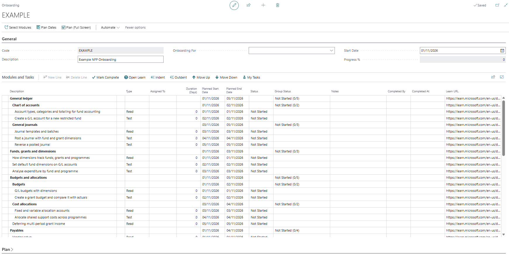
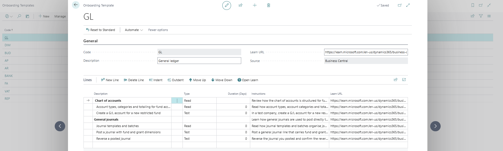
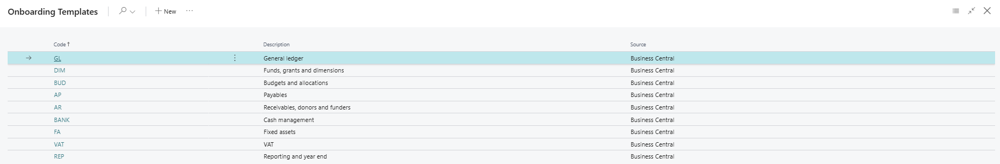
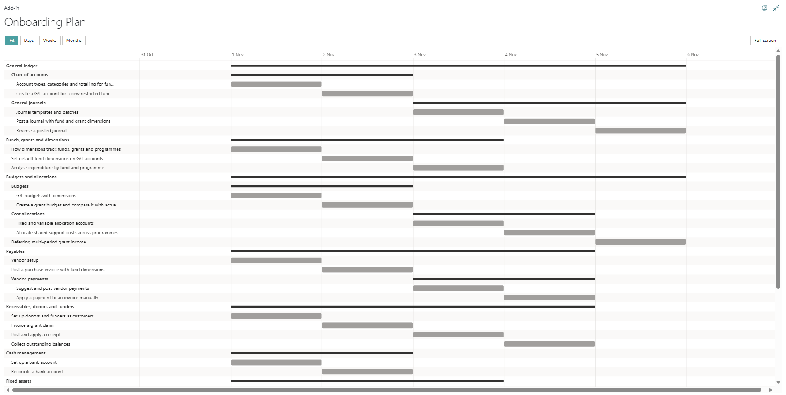
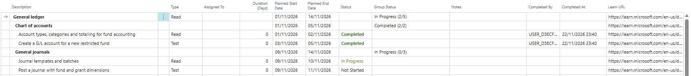
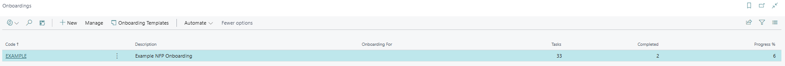

## TL;DR

Every new customer goes through the same onboarding: read up on the general
ledger, set up dimensions for funds and grants, post a test journal, run a
payment, and so on through the finance areas. We tracked that in spreadsheets
and emails, so nobody could say at a glance which areas were done, which were
tested and who was meant to be doing the rest.

So I built a small extension that keeps the onboarding inside Business Central:

- **Templates** of reusable modules and tasks. It ships with nine for the
  finance side of BC, aimed at not-for-profits, each task linked to the right
  Microsoft Learn article.
- **Onboardings** built from those templates, with nested tasks people work
  through, tick off and assign to each other.
- **Planning**, with durations, planned dates and a Gantt chart on the
  onboarding card.
- An **event** so another extension can add its own templates without touching
  this one.

It's a proof of concept: about 2,500 lines of AL and JavaScript, no
dependencies. This post walks through using it, then looks at how a few of the
parts work.

Here's the end result before we get into how it works:

<!-- TODO screenshot: onboarding card with the task tree and the Plan (Gantt) part -->
{: loading="lazy"}

## Why I bothered

Onboarding a customer onto Business Central isn't hard, but there's a lot of it.
A typical not-for-profit finance onboarding touches the general ledger, funds
and grants as dimensions, budgets, payables, receivables (donors and funders),
cash management, fixed assets, VAT and year end. Each area has something to read
and something to try in a test company.

Keeping track of that outside BC had the usual problems:

- The spreadsheet was always slightly out of date.
- "Done" meant different things to different people. Read about it? Tried it?
  Signed it off?
- Nobody linked to the documentation, so everyone went looking for the same
  Learn articles.
- Every customer got a fresh copy of the spreadsheet, and any improvement to the
  list never made it back to the master.

I wanted the checklist in the place the customer is already working, with the
Learn link one click away and progress worked out for me.

## The two pieces

There are two kinds of document, both built the same way: a header and lines,
like a sales order.

**Templates** are the reusable part. A template is a module, such as *General
ledger*, with tasks under it:

```
General ledger
  Chart of accounts                                          Read
    Account types, categories and totalling for funds        Read
    Create a G/L account for a new restricted fund           Test
  General journals                                           Read
    Journal templates and batches                            Read
    Post a journal with fund and grant dimensions            Test
    Reverse a posted journal                                 Test
```

Every task is either **Read** or **Test**, has instructions, and has a
Microsoft Learn link. The nine standard templates cover the finance areas above,
40 lines in all.

**Onboardings** are the working copies. You build one from templates, then
people work through it, tick tasks off and plan it.

## Walkthrough: onboarding a new customer

Here's the whole thing end to end, from install to a finished onboarding.

### 1. Install and give people access

Publish the extension to the customer's environment and assign the **ONB ALL**
permission set to everyone who'll take part. The standard templates are created
on install, so there's nothing else to set up.

### 2. Check the templates

Search for **Onboarding Templates**. You'll see the nine standard modules: GL,
DIM, BUD, AP, AR, BANK, FA, VAT and REP. If the list is empty, choose **Get
Standard Templates**.

Open one to see its lines. The templates belong to the customer, so tailor them
as much as you like:

- Edit any line, or add a customer-specific task with **New Line**.
- Shape the tree with **Indent**, **Outdent**, **Move Up** and **Move Down**. A
  line's sub-tasks always move with it.
- Create a new template from scratch for anything the standard set doesn't
  cover.

If you go too far, **Reset to Standard** puts a standard template back the way
it shipped. **Get Standard Templates** never overwrites anything: it only adds
templates you don't have.

{: loading="lazy"}

### 3. Create the onboarding

Search for **Onboardings** and choose **New**. Fill in:

- **Code** and **Description**, for example `NFP-FIN` and *Finance go-live*.
- **Onboarding For**, if this onboarding is for one person. Leave it blank for a
  shared one.
- **Start Date**, which planning works from.

### 4. Add modules

Choose **Select Modules**, tick the templates you need, and choose **OK**. Each
one is added as a module, with the template's tasks underneath, and a message
tells you how many tasks were added.


{: loading="lazy"}

You can run **Select Modules** again at any time. For a module that's already
there, it only adds template lines that are missing, so statuses, notes and
your own lines are never touched.

### 5. Make it fit this customer

The **Modules and Tasks** part works like the template lines. Add tasks with
**New Line**, delete the ones that don't apply, and rearrange with Indent,
Outdent, Move Up and Move Down. If a task doesn't apply but you want a record
of that, set its status to **Not Applicable** instead of deleting it. It won't
count against progress.

### 6. Share out the work

Set **Assigned To** on a task, or on a whole module. Assigning a group assigns
every task under it that was unassigned or assigned to the same person, and new
lines take their parent's assignee. Each person can then use **My Tasks** to
see only their own.

### 7. Plan it

Set **Duration (Days)** on the tasks, then choose **Plan Dates** on the card.
Every task gets planned start and end dates: modules run side by side from the
start date, and the tasks inside a module run one after another. You can also
type dates in by hand.

The **Plan** part on the card shows the result as a Gantt chart. Zoom with Fit,
Days, Weeks or Months, or choose **Plan (Full Screen)** for more room.


{: loading="lazy"}

### 8. Work through the tasks

For each task:

1. Choose **Open Learn** to read the Microsoft Learn article. If the task has
   no link of its own, it opens its parent's, then the template's.
2. Do the reading, or try it out in a test company.
3. Set **Status** to In Progress or Completed, and add **Notes** if anything
   came up.

Completing a task records who completed it and when. **Mark Complete** on a
module or group completes every open task under it in one go.

{: loading="lazy"}

### 9. Track progress

Modules and groups show a rolled-up **Group Status**, like `In Progress (2/5)`.
The card shows **Progress %**, and the **Onboardings** list shows the task count
and progress for every onboarding, so you can see at a glance who's nearly done
and who's stuck. On the chart, bars change colour as tasks move along.

{: loading="lazy"}

That's it: one place for the checklist, the documentation and the plan. The
rest of this post covers how a few of the parts work, for anyone building
something similar.

## Selecting a module twice without losing anything

Templates change. Someone adds a task to the VAT template six months in, and
you want it on the onboardings already running, without wiping anyone's
progress.

So **Select Modules** is safe to run again. Each onboarding line stores a
`Template Line ID`, the `SystemId` of the template line it came from. When a
module is selected again:

- Lines that already exist (matched on that ID) are left alone: status, notes,
  assignee and all.
- Missing lines are added, each one placed straight after the line copied from
  the template line before it, so it lands where you'd expect.
- Lines the user added by hand have no template line ID, so they're never
  touched.

Matching on `SystemId` rather than a task code means template lines can be
renamed or reordered without breaking the link. It's also why Move Up and Move
Down put lines back with their original `SystemId` when they reorder a block.

Placing a line "straight after" another needs a free line number in between. I
take the midpoint of the gap. There's no automatic renumbering when a gap is
used up: with steps of 10,000 that takes a lot of inserts in one spot, so
for now it's an error with a clear message, and a `shortcut:` comment in the
code saying so.

## Templates from other extensions

I wanted other apps (say a payroll or grants extension) to be able to ship
their own onboarding templates. The registry raises an event, and subscribers
register modules and tasks top to bottom:

```al
[EventSubscriber(ObjectType::Codeunit, Codeunit::"Onb. Template Registry", 'OnRegisterTemplates', '', false, false)]
local procedure RegisterMyTemplates(var Registry: Codeunit "Onb. Template Registry")
begin
    if not Registry.AddTemplateModule('PAYROLL', 'Payroll', 100, 'https://learn.microsoft.com/...') then
        exit; // the template already exists and belongs to the customer now

    Registry.AddTemplateTask('PAYROLL', '', 'PAY-10', 'Payroll setup', "Onb. Task Type"::Read,
        'Review the payroll setup.', 'https://learn.microsoft.com/...');
    Registry.AddTemplateTask('PAYROLL', 'PAY-10', 'PAY-11', 'Run a test payroll', "Onb. Task Type"::Test,
        'Run payroll for one employee in a test company.', '');
end;
```

Three details made this work:

**Create, never overwrite.** `AddTemplateModule` only creates a template whose
code doesn't exist yet, and returns false otherwise. Once a template exists,
it's the customer's. If they've edited it, the next refresh won't undo their
changes. If they want the original back, **Reset to Standard** deletes the
template and raises the event again.

**Knowing who called.** Each template records which extension provided it,
using `NavApp.GetCallerModuleInfo`. That's what Reset to Standard uses, and it
stops one extension adding tasks to another's template. It has to be called
directly inside the public procedure, since it returns whoever called *that*
procedure. Hide it in a helper and you get your own app back every time.

**Passing the registry by reference.** The event passes the registry codeunit as
a `var` parameter, so every subscriber writes into the same instance and it can
keep track of which templates were created in this refresh. `Registry := this;`
before raising the event is all it takes.

The nine standard templates use exactly the same event. The app is its own
first subscriber, so there's no special path for built-in content.

## A Gantt chart with no libraries

The plan is a control add-in: about 200 lines of plain JavaScript that draw
SVG. No charting library, nothing to load from a CDN. AL sends the lines as a
JSON array, with groups given the date span of the tasks under them:

```al
Line.Add('lineNo', OnbLine."Line No.");
Line.Add('description', OnbLine.Description);
Line.Add('indent', OnbLine.Indentation);
Line.Add('isGroup', HasChildren(OnbLine));
Line.Add('start', FormatIsoDate(StartDate));   // Format(Value, 0, 9) gives yyyy-mm-dd
Line.Add('end', FormatIsoDate(EndDate));
Line.Add('status', GetRollupStatus(OnbLine).AsInteger());
```

Bars are coloured by status, a dashed line marks today, and you can zoom to fit
or to days, weeks or months. **Plan (Full Screen)** opens the same chart on its
own page when the card part is too small.

Two things worth knowing if you build one yourself:

- **Wait for the control.** The page can't call the add-in until it says it's
  loaded, so there's a `ControlReady` event that sets a flag. Data is sent from
  there and from `OnAfterGetCurrRecord`, whichever comes second.
- **Use `textContent` for labels.** Descriptions are typed by users. Putting
  them in with `textContent` instead of building markup means a task called
  `` is just a funny task name.

Planning itself is kept simple on purpose: modules run side by side from the
start date, and the tasks inside a module run one after another. Durations are
calendar days. There's no base calendar or weekend handling yet, which is
another `shortcut:` comment waiting for a customer to need it.

## What I'd do next

- A test app covering the tree logic: indent, outdent, moving blocks, and
  re-selecting a module after lines were deleted and added
- Working-day planning against a base calendar
- Renumbering lines automatically when a gap runs out
- Separate admin and user permission sets instead of one `ONB ALL`
- A Role Center cue showing open tasks assigned to me

But the spreadsheet is gone, the Learn links are one click away, and "how far
along are we?" is a number on a page. That was the whole point.

---

**Source:** [LewisHyett/BC-Onboarding](https://github.com/LewisHyett/BC-Onboarding)
— the full extension, with a README covering setup, the standard templates and
how to register your own.
